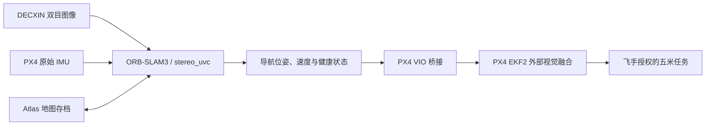

# ORB-SLAM3 · Nano 无人机导航

南京理工大学江阴校区 Combat 战队 RoboMaster 2027 无人机导航工程。
`nano` 分支面向 Jetson Orin Nano，使用 DECXIN（德创信）双目相机和 PX4 原始 IMU，提供视觉惯性定位、地图恢复及 PX4 外部里程计接口。

## 当前配置

| 项目 | 配置 |
|---|---|
| 平台 | Jetson Orin Nano，Ubuntu 22.04 / aarch64，JetPack 6.2 |
| 中间件 | ROS 2 Humble，PX4 1.17，Micro XRCE-DDS Agent |
| 相机 | DECXIN 双目 UVC 模组，MJPEG 输入 2720×960 @ 30 fps |
| 每目处理尺寸 | **960×720**（常驻服务使用 `light`） |
| ORB 特征数 | **`ORBextractor.nFeatures: 1000`** |
| 惯性数据 | PX4 `SensorCombined`，约 100 Hz |
| 处理后端 | GPU 双目校正与 FAST，CPU 金字塔层级并行 |
| 定位入口 | `stereo_uvc`，常驻服务加载标定后的 IMU 配置 |
| 记录 | 连续状态内录、逐帧导航及自动验证；图像内录默认关闭 |

原始图像裁剪后每目为 1280×960，再缩放到 960×720 参与跟踪。
`DECXIN_Camera.yaml` 保留全尺寸标定，常驻服务使用 `DECXIN_Camera_Light.yaml`；
直接运行启动器默认选择 `full`，需要显式指定 `light` 才与服务的处理尺寸一致。
各尺寸的含义和性能记录见 [处理配置](docs/RESOLUTION_PROFILES.md)。

相机旋转外参和时间偏移已有独立验证，早期标定配置完成过 VIBA2。
当前惯性入口约 13 fps，保留时间标定对应的单缓冲取流；长期 IMU 连续性、当前处理配置下的空中初始化、EV 融合及五米闭环飞行仍待验收。
详细状态见 [五米任务流程](docs/DECXIN_FIVE_METRE_FLIGHT.md) 和 [标定记录](docs/DECXIN_EXTRINSICS_20261110.md)。

## 使用入口

| 需要做的事 | 文档 |
|---|---|
| 查看服务、日志和运行状态 | [操作手册](操作手册.md) |
| 安装设备侧服务 | [Nano 部署](nano/README.md) |
| 编译、选择目标和运行测试 | [构建说明](docs/BUILDING.md) |
| 了解初始化、拨档和五米任务 | [五米任务流程](docs/DECXIN_FIVE_METRE_FLIGHT.md) |
| 查找录制、标定、接口或历史资料 | [文档目录](docs/README.md) |

## 数据链路



定位服务 `px4-vio.service` 负责 DDS Agent、状态内录与 SLAM；
`pilot-navigation.service` 负责导航验证和遥控器授权任务。
视觉观测发布需通过惯性成熟度、时间同步和状态检查；任务还要求实际 EV 融合及物理拨档授权。
两项服务的进程存在不等于导航就绪。

地图恢复支持保存 Atlas、重置后再初始化、加载旧图和几何对齐。
`FILE LOAD SUCCESS` 表示存档读入，`ALIGNMENT SUCCESS` 表示几何对齐通过。
碰撞后自主回正与空中跨地图连续导航尚未完成整机验收。

## 获取与检查

```bash
git clone --branch nano --single-branch https://github.com/MalzaharGeng/ORB_SLAM3.git
cd ORB_SLAM3
```

编译依赖、CUDA 和 PX4 开关见 [构建说明](docs/BUILDING.md)。已有构建时，可先检查路径和动态库：

```bash
VIO_PROCESSING_PROFILE=light bash ./run_recovery_test.sh --headless --check
ctest --test-dir build --output-on-failure
```

`--check` 不连接相机。测试使用实际构建目录；离线和合成测试结果不代替实机验收。
日常服务的状态查看与手动诊断见 [操作手册](操作手册.md)。

## 仓库目录

```text
include/、src/        SLAM、导航状态、IMU 接收与 PX4 桥接
Examples/            传感器入口、数据集示例与相机标定
config/              IMU、桥接及启动配置
nano/                设备服务、守护脚本、任务服务与现场记录
tests/               回归测试、录制回放与性能检查
docs/                构建、标定、接口和历史记录
scripts/、tools/     依赖准备、诊断与数据工具
Examples_old/        上游旧版示例
Thirdparty/          DBoW2、g2o、Sophus
Vocabulary/          ORB 词典
```

`master` 和 `nano` 分别维护。事故数据、测试数据及部署归档的位置见 [分支约定](docs/GIT_CONVENTIONS.md)。
原始录制、构建产物及设备依赖不进入代码主线。旧 D435i 手册与验证记录见 [历史资料](docs/README.md#历史资料)。

## 来源与许可证

定位算法基于 [UZ-SLAMLab/ORB_SLAM3](https://github.com/UZ-SLAMLab/ORB_SLAM3)，官方基准为 `4452a3c`。
地图恢复、初始 IMU 导航、终端控制及 PX4 接入合并自 [Kuroneko-avi/ORB_SLAM3](https://github.com/Kuroneko-avi/ORB_SLAM3)，保留原始提交和作者信息。
修改来源见 [本地修改说明](docs/LOCAL_CHANGES.md)，上游使用说明见 [原始 README](docs/UPSTREAM_README.md)。

本仓库采用 [GNU GPL v3](LICENSE)，第三方组件遵循各自许可证。学术使用请引用：

```bibtex
@article{ORBSLAM3_TRO,
  title={{ORB-SLAM3}: An Accurate Open-Source Library for Visual, Visual-Inertial and Multi-Map {SLAM}},
  author={Campos, Carlos and Elvira, Richard and G\'omez, Juan J. and Montiel, Jos\'e M. M. and Tard\'os, Juan D.},
  journal={IEEE Transactions on Robotics},
  volume={37},
  number={6},
  pages={1874--1890},
  year={2021}
}
```
