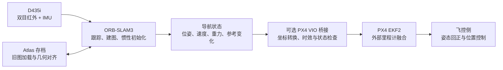

# Combat UAV Navigation · RoboMaster 2027

**南京理工大学江阴校区 Combat 战队 2027 赛季无人机导航方案。** 基于 ORB-SLAM3，使用 RealSense D435i 的双目红外图像与 IMU 进行视觉惯性定位，并通过可选的 ROS 2 / PX4 接口向飞控提供外部里程计。

方案重点是碰撞扰动后的状态恢复：机体受到撞击、姿态发生突变或视觉短时丢失后，由飞控完成姿态回正，导航侧恢复可信的位姿与速度输出，为位置保持和后续航迹恢复提供依据。围绕这条链路，仓库保留了地图保存与加载、重置后重新初始化、跨地图几何对齐，以及统一导航坐标系下的状态接口。

目前已完成定位与恢复流程的基础实现、离线回归和合成数据测试。**碰撞后自主回正与导航恢复仍是整机联调目标**，尚无本分支的实飞验收结果；当前地图恢复由终端或 GUI 分阶段确认。

## 系统分工



| 部分 | 职责 |
|---|---|
| 视觉惯性定位 | 处理双目图像与 IMU，估计运动状态，维护局部地图 |
| 地图恢复 | 保存首次地图；重置后建立第二张地图，再与首次地图匹配、对齐 |
| 导航接口 | 在一致的参考系中输出相机/IMU 位姿、速度及有效性信息 |
| PX4 桥接 | 将观测转换为飞控使用的 FRD 表达，检查跟踪、初始化、时钟和链路状态 |
| 飞控 | 完成姿态与位置控制；碰撞后的回正策略需要结合机体和控制器单独验证 |

仓库包含定位、地图恢复与通信代码。碰撞检测、回正控制律和航迹恢复策略需要在整机控制侧继续接入。

## 碰撞后的定位恢复

恢复分为两种情况。短时失去图像约束时，优先恢复当前地图内的跟踪；如果原地图已经无法继续使用，则重新初始化，并通过保存的地图找回原有位置参考。

当前可复现的跨地图流程如下：

1. **首次建图**：提供足够的运动激励，完成 IMU 初始化及 VIBA 2，保存 Atlas。
2. **重置与再初始化**：清理旧的跟踪状态，建立第二张地图，重新完成惯性初始化。
3. **加载首次地图**：独立读入存档，保留当前地图用于跟踪。
4. **几何对齐**：匹配两张地图，检查几何支持和连续估计的一致性，再将导航输出转换到首次地图的参考系。

文件读入和定位恢复是两个阶段：`FILE LOAD SUCCESS` 表示存档可用，`ALIGNMENT SUCCESS` 表示几何对齐通过。匹配评分用于工程判断，不是定位正确的概率。

PX4 桥接在跟踪失效、观测过期或时钟异常时停发。地图参考变化后，当前实现要求飞控处于**未解锁状态**，待观测稳定再建立发布参考。因此，地面重置与读档流程尚不能直接用于空中跨地图连续导航。

恢复速度需要结合运动激励、场景纹理、优化耗时和飞控状态实测。默认 `IMU.VIBA1Time=5.0`、`IMU.VIBA2Time=15.0` 是运动门控计时 `mTinit` 的累计触发阈值，不能作为“撞击后多少秒恢复”的指标。参数含义见 [IMU 初始化配置](tests/IMU_INITIALIZATION_CONFIG.md)。

## 编译

核心依赖为 Linux、C++17 编译器、CMake ≥ 3.16、OpenCV ≥ 4.4、Eigen3 ≥ 3.1、Pangolin、Boost.Serialization 和 OpenSSL。DBoW2、g2o 与 Sophus 源码随仓库提供；D435i 入口另外需要 RealSense SDK。

```bash
git clone https://github.com/MalzaharGeng/ORB_SLAM3.git
cd ORB_SLAM3

BUILD_JOBS=2 bash ./build.sh \
  -DORB_SLAM3_BUILD_TESTS=ON \
  -DCMAKE_EXPORT_COMPILE_COMMANDS=ON
```

Pangolin 安装在自定义目录时，追加 `-DCMAKE_PREFIX_PATH=/path/to/pangolin`。本机使用的前缀为 `$HOME/local/pangolin-0.9.6`，其他机器按实际安装位置填写。

`BUILD_DIR` 默认是仓库内的 `build/`，`BUILD_JOBS` 默认是 2。核心库和示例均输出到构建目录；词典文本不存在时，脚本会解压仓库中的压缩词典。

```text
build/lib/libORB_SLAM3.so
build/Examples/Stereo-Inertial/stereo_inertial_realsense_D435i
build/tests/d435i_recovery_replay
build/tests/stereo_inertial_save_replay
```

D435i 可执行文件仅在 CMake 找到 RealSense SDK 后生成。无 GUI 模式关闭显示窗口，构建仍依赖 Pangolin。官方单目、双目、RGB-D 及惯性数据集示例继续保留，使用方法见 [上游文档](docs/UPSTREAM_README.md)；调用路径需加上实际构建目录前缀。

## 运行与调试

### D435i 实机入口

从仓库根目录启动：

```bash
# 先检查程序、配置和动态库，不连接相机。
./run_recovery_test.sh --headless --check

# 无 GUI 运行，终端控制恢复阶段。
./run_recovery_test.sh --headless

# 本机图形界面；SSH X11 转发使用 --ssh-x11。
./run_recovery_test.sh --gui
```

| 指令 | 操作条件与作用 |
|---|---|
| `first` | 首次 VIBA 2 完成且跟踪正常后，保存地图 |
| `reset` | 保存成功后，全量重置并开始第二次建图 |
| `second` | 第二次 VIBA 2 完成后，检查并确认初始化状态 |
| `load` | 进入 `SECOND_READY` 后，加载首次地图并等待几何对齐 |
| `status` / `pose` | 查看阶段、保存状态和导航位姿 |
| `quit` | 停止采集并关闭 SLAM 工作线程 |

每条推进指令都需要等待对应成功状态，`queued` 只表示请求已排队。相机与 IMU 参数位于 [RealSense_D435i.yaml](Examples/Stereo-Inertial/RealSense_D435i.yaml)，显示与终端配置位于 `config/recovery_*.conf`。完整操作见 [终端与 SSH 说明](tests/REMOTE_AND_CONSOLE.md)。

### 离线回放

```bash
RECORDING_DIR=/path/to/recording ./run_recovery_test.sh --replay --headless

# 使用独立构建目录时，构建与运行使用相同的 BUILD_DIR。
BUILD_DIR="$PWD/build_sync" RECORDING_DIR=/path/to/recording \
  ./run_recovery_test.sh --replay --headless
```

录制目录需要包含 `settings.yaml` 和脚本要求的图像、IMU、重置时刻等输入，数据不随仓库分发。回放会记录导航结果、恢复阶段与处理耗时。不同初始化阈值的重复实验见 [回放性能测试](tests/REPLAY_BENCHMARK.md)。

## 导航接口与坐标约定

内部 SLAM 地图、导航世界系和飞控参考系分别承担不同用途，接入控制器时需要明确区分。

| 接口 / 字段 | 含义 |
|---|---|
| `TrackStereo()` | 保留 ORB-SLAM3 的返回约定：内部地图到相机的 `Tcw` |
| `GetNavigationState()` | 同一快照中的位姿、速度、重力、跟踪状态与参考变化信息；先检查 `valid` |
| `GetCurrentPose()` | 左相机到导航世界系的位姿 |
| `GetCurrentImuPose()` | IMU 到导航世界系的位姿 |
| `velocityWorld` / `gravityWorld` | 导航世界系中的速度与重力；速度另检查 `velocityValid` |
| `referenceEpoch` | 标识导航参考变化，供接入端处理重置和坐标跳变 |

导航世界系取当前地图首个关键帧时刻的 **IMU 坐标系**。完成旧图几何对齐后，输出转换到首次保存地图的初始 IMU 坐标系。相机光心与 IMU 中心存在安装偏移，初始相机位置不必为零；初始 IMU 的轴向也不自动等同于 ENU 或 NED。

变换方向、地图点转换与跨地图组合公式见 [导航坐标系说明](tests/NAVIGATION_FRAME.md)。

## PX4 接入

桥接默认关闭。启用前需要安装兼容的 ROS 2、PX4 1.17 `px4_msgs` 与 Micro XRCE-DDS Agent。现有部署说明基于 Ubuntu 22.04 / ROS 2 Humble，具体版本和环境准备见 [PX4 VIO 接入](tests/PX4_VIO.md)。

在依赖和 ROS 环境已准备好的终端中编译：

```bash
BUILD_JOBS=2 bash ./build.sh \
  -DORB_SLAM3_BUILD_TESTS=ON \
  -DORB_SLAM3_WITH_PX4=ON

# 填写安装外参后启动；Agent 在另一终端运行，步骤见 PX4 接入文档。
./run_recovery_test.sh --headless --px4-config /path/to/px4_vio.yaml
```

以 [config/px4_vio.yaml](config/px4_vio.yaml) 为模板，填写实测的 `R_BI` 后再设置 `extrinsics_valid: 1`。它表示 D435i IMU 到机体 FRD 的旋转；IMU 相对机体重心的平移仅在 PX4 的 `EKF2_EV_POS_X/Y/Z` 中配置，避免重复补偿。

桥接发布位置、速度、姿态与重置计数，并回读飞控和时间同步状态。输出采用重力对齐、任意初始航向的 FRD 参考系；首次建立参考要求未解锁。默认还要求 VIBA 2 完成、速度有效、连续稳定跟踪 1 s，且观测时龄不超过 200 ms。具体门限与停发条件见接入文档，1 s 稳定窗口不代表整条链路的恢复耗时。

## 已完成的验证

以下为 **2026-10-30 本分支在 Ubuntu WSL 中的检查结果**。Avi 文档中的历史实机与仿真记录单独保留，未计入本表。

| 检查 | 结果 |
|---|---|
| 核心与示例构建 | 核心库、DBoW2/g2o、24 个普通数据集 Examples 构建通过；96 个 C++ 编译单元使用 C++17 |
| CTest | 7/7 通过，覆盖参数读取、Atlas 序列化、变换组合、终端控制、启动路径、无特征帧与离线 PX4 转换 |
| 合成双目惯性回放 | 完成 VIBA 1/2、5 次在线保存、写入失败重试、存档读回及重置状态检查 |
| 导航状态 | 检查 810 个有效快照及 736 个含速度快照的时间、参考系与数值一致性 |
| 合成 RGB-D + Viewer | 40 帧正常运行并退出；仍有 Qt 跨线程计时器警告 |

```bash
ctest --test-dir build --output-on-failure
./build/tests/stereo_inertial_save_replay \
  Vocabulary/ORBvoc.txt /tmp/orb-save-smoke
```

本次环境缺少 RealSense SDK 和 `px4_msgs`，未构建 D435i 入口及 ROS/PX4 桥接。真实相机、完整实录跨地图恢复、飞控通信、碰撞回正、实飞精度与恢复时间均需继续验收。合成数据结果仅用于检查实现，不能代替整机性能指标。配置、日志位置和完整边界见 [验证报告](docs/AVI_SYNC_2026-10-30.md)。

## 代码来源与维护

定位算法基于 [UZ-SLAMLab / ORB-SLAM3](https://github.com/UZ-SLAMLab/ORB_SLAM3)，官方基准为 `4452a3c`。地图恢复、初始 IMU 导航、D435i 终端控制及 PX4 接入合并自 [Kuroneko-avi / ORB_SLAM3](https://github.com/Kuroneko-avi/ORB_SLAM3)，当前同步至 `b9ba5ec`（含测试命令汇总），保留原始提交和作者信息。

本分支维护 C++17 / 现代 CMake 适配、构建树输出、依赖目标链接、线程退出与启动路径修复，并补充恢复流程的回归检查。ORB-SLAM3 原作者为 Carlos Campos、Richard Elvira、Juan J. Gómez Rodríguez、José M. M. Montiel 与 Juan D. Tardós；功能来源及本地修改见 [修改说明](docs/LOCAL_CHANGES.md)。

```text
include/、src/          SLAM、导航状态与 PX4 桥接
Examples/              传感器入口、数据集示例与相机配置
Examples_old/          上游旧版示例
config/                恢复启动配置与 PX4 参数模板
tests/                 回归测试、回放与性能统计
scripts/               可选 PX4 依赖与 Agent 工具
Thirdparty/            DBoW2、g2o、Sophus
Vocabulary/            ORB 压缩词典
docs/                  接入说明、来源与验证记录
build.sh               统一构建入口
run_recovery_test.sh   实机与回放启动入口
```

后续联调重点是完整实录恢复、飞控侧姿态回正，以及参考变化期间的定位接管策略。记录实验时保留相机与安装外参、初始化参数、飞控版本、跟踪状态、恢复阶段和时间戳，以便比较不同配置的效果。

## 许可证与引用

本仓库沿用 [GNU GPL v3](LICENSE)，第三方组件遵循各自许可证。使用、修改和分发时请保留原作者与第三方版权声明。

学术工作中使用 ORB-SLAM3，请引用原论文：

```bibtex
@article{ORBSLAM3_TRO,
  title={{ORB-SLAM3}: An Accurate Open-Source Library for Visual, Visual-Inertial and Multi-Map {SLAM}},
  author={Campos, Carlos and Elvira, Richard and G\'omez, Juan J. and Montiel, Jos\'e M. M. and Tard\'os, Juan D.},
  journal={IEEE Transactions on Robotics},
  volume={37},
  number={6},
  pages={1874--1890},
  year={2021}
}
```

测试入口、参数与输出位置见 [测试命令汇总](tests/TEST_COMMANDS.md)。2026-10-31 的文档增量合并与设备同步范围见 [本轮记录](docs/AVI_SYNC_2026-10-31.md)。
