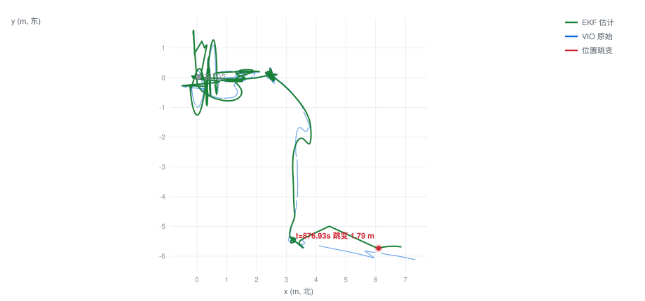
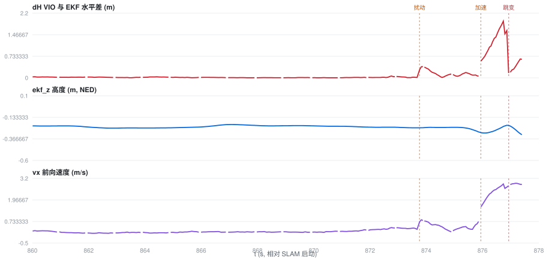

# 首次炸机（2026-11-03 · run 6nQrcY）

2026-11-03 23:09 的这次飞行，是这套 ORB-SLAM3 + PX4 第一次在空中成功建立 VIO 参考系
的会话。飞行到 t ≈ 876.9 s 时出现 1.79 m 的位置阶跃，随后持续前倾俯冲坠地；
日志在 t ≈ 877.4 s 中断，中断时 `armed` 仍为 1。

本分支只放这一次的数据、分析产物和复现脚本，不含源码，与 `master` 没有共同历史。

## 目录

```
.
├── data/                              原始证据，未改动
│   ├── px4_telemetry.csv              3345 行 × 38 列，15 Hz，桥接端逐帧记录
│   ├── run.log                        SLAM 控制台全量日志（含 [PX4] 桥接行、VIBA 阶段）
│   ├── inrec_19700101_080117_live_6nQrcY.csv   内录，3400 行
│   ├── px4.yaml                       桥接配置快照（R_BI、std、stable/max_age）
│   ├── settings.yaml                  SLAM 参数快照
│   └── launch.txt                     本次启动命令行与操作顺序
├── docs/
│   └── crash-6nQrcY.md                会话总览、状态跃迁、跳变表、坠机前 5 秒逐帧、结论
├── figures/
│   ├── trajectory.svg                 水平轨迹与 VIO/EKF 偏差
│   └── timeline.svg                   EV 标志、速度、高度时间线
├── replay/
│   └── replay_6nQrcY.html             单文件回放页，2629 帧
└── scripts/
    ├── replay_crash.py                逐帧打印遥测
    ├── make_excerpt.py                生成 docs/crash-6nQrcY.md
    ├── make_figures.py                生成两张 SVG
    └── make_replay_data.py            生成回放页的内嵌数据
```

## 相关位置

| 内容 | 位置 |
|---|---|
| 回放动画（浏览器直接看） | <https://malzahargeng.github.io/ORB_SLAM3/replay/replay_6nQrcY.html> |
| 原始记录（设备） | `/home/nano/ORB_SLAM3/recordings/test_runs/19700101_080117_live_6nQrcY/` |
| 原始内录（设备） | `/home/nano/inrec/inrec_19700101_080117_live_6nQrcY.csv` |
| SLAM 参数来源 | [master: Examples/Stereo-Inertial/RealSense_D435i.yaml](https://github.com/MalzaharGeng/ORB_SLAM3/blob/master/Examples/Stereo-Inertial/RealSense_D435i.yaml) |
| 桥接参数来源 | [master: config/px4_vio_local.yaml](https://github.com/MalzaharGeng/ORB_SLAM3/blob/master/config/px4_vio_local.yaml) |
| 桥接与内录代码 | [master: src/Px4Vio.cc](https://github.com/MalzaharGeng/ORB_SLAM3/blob/master/src/Px4Vio.cc)、[src/InputRecording.cc](https://github.com/MalzaharGeng/ORB_SLAM3/blob/master/src/InputRecording.cc) |
| 试验机部署与飞控参数 | [nano 分支](https://github.com/MalzaharGeng/ORB_SLAM3/tree/nano) |
| 本分支快照 | [tag first-crash-20261103](https://github.com/MalzaharGeng/ORB_SLAM3/releases/tag/first-crash-20261103) |

`data/px4.yaml` 与 `data/settings.yaml` 是当时的快照，用来对照现在的 master 配置改了
什么；要跑复现只看本分支即可，不需要源码。

## 数据说明

`px4_telemetry.csv` 是桥接端每帧向 PX4 发完 EV 之后立刻记的，列含：EV 三路标志
（`ev_pos` / `ev_hgt` / `ev_vel`）、`local_xy_valid`、VIO 位姿 `px/py/pz`、
EKF 位姿 `ekf_x/y/z` 与速度、`armed`、`nav_mode`、`age_ms`、`sent/rejected`。
坐标是 PX4 local NED（x 北、y 东、z 向下）。

`t` 一律指相对 SLAM 启动的秒数（会话内 08:01:15 起算）。

## 结论

1. 悬停阶段 dH（VIO 与 EKF 的水平差）= 0.00 m，外参、坐标对齐在静止时没有问题。
2. 一动 dH 就随速度单向增长：0.1 m/s 档均值 0.03 m，1.6 m/s 档 0.23 m，
   到 2.8 m/s 时 1.93 m。实测观测时延约 105 ms，在 2.8 m/s 下只能解释 0.3 m。
3. t ≈ 876.93 单帧水平跳变 1.79 m，dH 从 1.61 骤降到 0.16 —— EKF 把位置强制
   拉回 VIO。
4. 这次阶跃对位置控制器相当于 1.8 m 的给定突变，姿态大幅修正，表现为持续前倾
   俯冲；高度同步从 −0.22 沉到 −0.32。
5. 同一形态在 t ≈ 698.56（EV 首次接上）也出现过一次，1.67 m，dH 从 1.47 降到
   0.15。当时速度只有 0.27 m/s，所以没有炸。
6. 数据在 t ≈ 877.4 中断，`armed` 仍为 1。

## 根因与更正

**根因**：`EKF2_EV_CTRL = 11`，只打开位置与航向，速度位没开。遥测 3345 帧
`ev_vel` 全为 0，`run.log` 末行 `EV(pos/hgt/vel)=1/1/0` 与此一致。EV 不给速度，
EKF 只能用 15 Hz、约 105 ms 时延的位置观测去推速度；速度越高推算误差越大，
残差累积到门限后 EKF 执行位置重对齐，就是上面那两次跳变。触发条件是
「高速 + 只有位置观测」。

**更正**：此前把原因归到「`cs_yaw_align` 恒为 0，位置错系」，这次的数据不支持。
内录 3400 行里 `cs_ev_yaw = 1` 有 2673 行（`cs_ev_pos`、`cs_ev_hgt` 同为 2673 行），
说明 yaw 对齐是成功的。跳变源于融合配置缺速度观测，不是坐标系映射错，原结论作废。

## 复现

脚本只用标准库，在仓库根目录跑：

```bash
python3 scripts/make_excerpt.py      # 重写 docs/crash-6nQrcY.md
python3 scripts/make_figures.py      # 重写 figures/*.svg
python3 scripts/make_replay_data.py  # 生成 replay/replay_data.js（回放页已内嵌，平时不用跑）
python3 scripts/replay_crash.py      # 终端逐帧打印；可传 csv 路径覆盖默认值
```

回放页是自包含的单文件，下载后双击就能拖动时间轴看当时的 VIO/EKF 分离过程；在线看
用上面「相关位置」里那条链接。





## 运行环境

| 项 | 值 |
|---|---|
| 载机 | 试验机 Nano（Orin Nano Super），D435i 水平安装，镜头朝机头 |
| SLAM | ORB-SLAM3 双目惯性，640 × 480 @ 15 fps，nFeatures 1000 |
| 初始化 | `IMU.fastInit: 0`，VIBA 3 s / 10 s 两段 |
| 桥接 | `position_std 0.1 m`、`velocity_std 0.2 m/s`、`stable 0.15 s`、`max_age 0.70 s` |
| 参考系 | `allow_airborne_reference: 1`（空中首个有效样本即原点） |
| 飞控 | PX4，`EKF2_EV_CTRL = 11`，POSCTL |
| 外参 | `R_BI` 为实测安装矩阵，杆臂只在飞控侧配 `EKF2_EV_POS_X/Y/Z` |

## 后续

1. 桥接端补发 `twist`（速度）并同时打开 `EKF2_EV_CTRL` 的速度位，从源头去掉
   "用位置推速度"这一环。
2. 短期可以把最大水平速度压到 1.5 m/s 以下，并按实测 105 ms 校准 `EKF2_EV_DELAY`。
3. 提高 EV 输出频率（当前 15.98 Hz，受相机 15 fps 限制），或换更快的相机链路。
