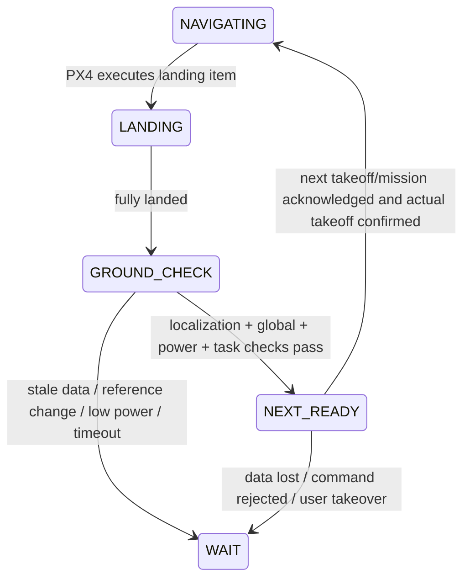

# Repeated PX4 navigation missions with VIO

The bridge supplies localization. PX4 executes global waypoints using the user's existing verified VIO-to-global transform. Landing does not reset the navigation frame, and an ordinary stop/takeoff can remain armed. The bridge publishes no arm, takeoff, land, mode-change or mission commands.

## Motion-fault recovery

`allow_armed_landed_recovery: 1` opts in. A motion inconsistency still stops VIO publication immediately in the air. Recovery requires all of:

- Fresh `VehicleLandDetected` with the full `landed` state; `ground_contact`/`maybe_landed` alone are insufficient. Both source timestamp and reception age are checked. Freefall/motion indications block recovery.
- Fresh status, reader, valid synchronization and unexpired VIO input; valid tracking, IMU initialization, BA2 and finite velocity/pose remain mandatory.
- VIO and finite PX4 local velocity magnitudes at or below `landed_max_speed_m_s` (default 0.2m/s). PX4 navigation validity may recover only after VIO resumes; readiness separately requires valid navigation and fusion, avoiding a circular bootstrap condition.
- New observations at intervals <=0.2s, with position stable within 0.1m (or the stricter residual gate), attitude within 5 degrees, continuously for `landed_stable_seconds` (minimum/default 2s).
- The pose has returned within `max_position_residual_m` of the last checked pre-fault pose. A permanently displaced pose cannot become trusted merely by standing still.

Recovery clears only the motion comparison window and requires `stable_seconds` of good input before output resumes. The transform, origin and reset_counter stay fixed. An isolated landed pulse, repeated polling, stale source messages, uninitialized input or movement cannot release the latch. Map/clock/PX4-frame changes still require disarm and global-reference revalidation.

Normal landing without a fault needs no recovery or reset. The same mature map and BA2 state are retained. Cold-starting a fresh inertial map while motionless is a different initialization problem; landing cannot substitute for missing excitation.

## Localization health interface

Topic: `/vio/navigation_health`, `std_msgs/String` JSON, schema_version=1, 5Hz, reliable volatile QoS; DDS domain and topic prefix follow the bridge configuration. Tests use domain43 and `/vio_test/vio/navigation_health`.

Fields: `instance_id`, `timestamp_us`, `steady_us`, `navigation_ready`, `ground_ready`, `ground_confirmed`, `armed`, `landed`, `airborne_fault`, `requires_disarm`, `ground_recoveries`, `reset_counter`, `reference_epoch`, `clock_epoch`, `px4_xy_reset_counter`, `px4_z_reset_counter`, `px4_heading_reset_counter`, `reason`, `gate_reason`, `fault_reason`.

`navigation_ready` requires fresh accepted observations, valid fresh PX4 XY/Z and velocity, fresh EV position-fusion status, reader/status/synchronization and no gate fault. It does not require EV velocity fusion when the existing EKF configuration intentionally fuses only EV position. `ground_ready` adds confirmed stationary landed evidence.

Neither flag is a complete permission to launch. The task sequencer must also check:

1. Health heartbeat received within 0.5s using its own monotonic clock. No latched last-good status after publisher loss. Sequence/timestamp monotonicity and expected schema must hold.
2. The verified global converter is current and explicitly bound to `(instance_id, reset_counter, reference_epoch, clock_epoch)` plus PX4's XY/Z/heading reset counters; a process restart or frame change revokes its prior authorization.
3. Fresh PX4 global-position/home validity, preflight checks, battery reserve and intended arm/mode state. Global origin, altitude datum and yaw remain the converter's responsibility.
4. An explicit next-task request, mission upload/current-item acknowledgements, correct next takeoff item, and actual mode confirmation. No repeated commands from each 5Hz healthy message. Abort/retry timers must be bounded.

## Landing and next-task sequencing

Suggested states:

PX4 may advance immediately from an auto-continue LAND to the next item when it recognizes landed. A LAND→TAKEOFF list alone does not guarantee a pause or honor the bridge health flag. To guarantee a dwell, use an explicit paused landing boundary plus a task sequencer to advance/resume only after checks, or an equivalent firmware-validated mission mechanism. Confirm actual firmware semantics in SITL/HIL; the desktop PX4 source inspected here is d6f12ad and is not proof of the aircraft's exact firmware build.

COM_DISARM_LAND commonly defaults to 2s. A motion-fault recovery needs at least 2s of landed evidence plus the 1s observation stability window, communication and mission acknowledgement margins. Choose a bounded ground dwell and auto-disarm deadline together. Do not turn off the timeout globally merely to pass a test. On timeout, end the armed-stop attempt; a subsequent disarmed launch needs a new preflight/arming cycle.

Verify position-loss, RC/manual takeover, battery and mission-command failure behavior in PX4. An unconditional companion NAV_LAND is not a substitute for those failsafes, especially when position is already invalid.

## What the current tests prove

`px4_sortie_regression`: normal two-sortie frame preservation; motion recovery only at confirmed ground; opt-out; stale/missing/partial landed states; bounce; movement; corrupt input; clock/map blocking; duplicate polling; readiness expiry/fusion loss; permanent pose displacement; stale-source replay and config validation.

`px4_sortie_ros_regression`: actual ROS/DDS messages and status serialization in an isolated domain, mock armed flight→fault→landing→recovery→second takeoff plus hard-clock blocking. It sends no vehicle commands and does not spin real motors. It is not a physical flight test or a PX4 mission-loop test.

## Corrections to earlier summaries

- Matching source hashes proves source consistency, not absence of drift or autonomous-flight readiness.
- Restoring a credible startup year does not prove camera/IMU timing accuracy or make every DDS rejection disappear.
- A position-versus-integrated-velocity consistency window does not measure absolute position truth. A drift common to pose and velocity can pass regardless of the 0.8m threshold.
- Tolerating a 1.5s sample gap does not create missing measurements, guarantee gap-free delivery or ensure PX4 maintains fusion for that interval.
- The original regression cases reproduce selected recorded boundary conditions; they are not a full raw-flight replay of the closed-loop mission.
